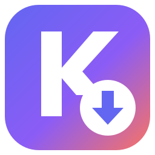
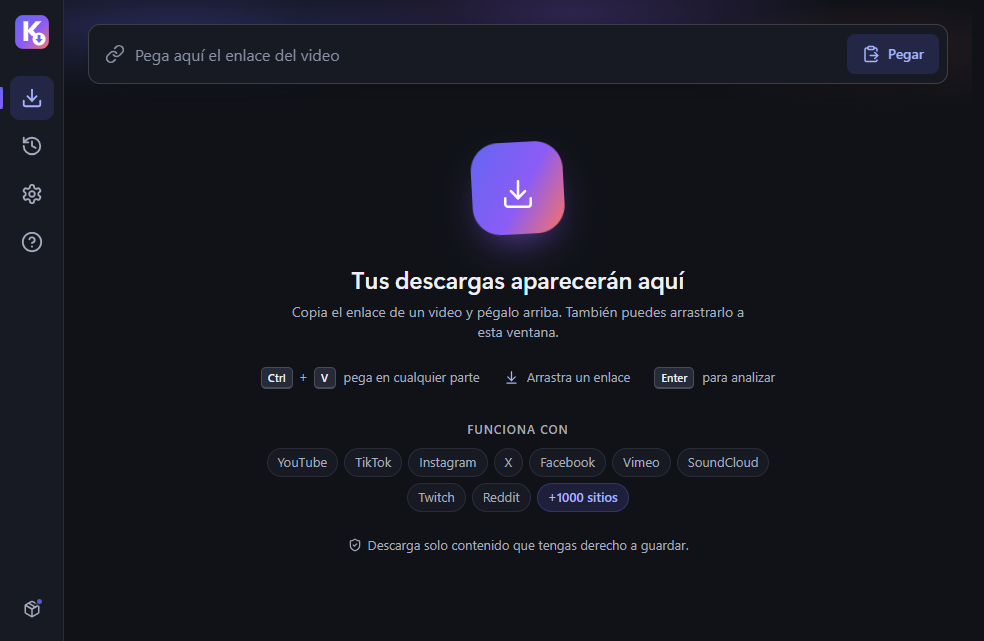
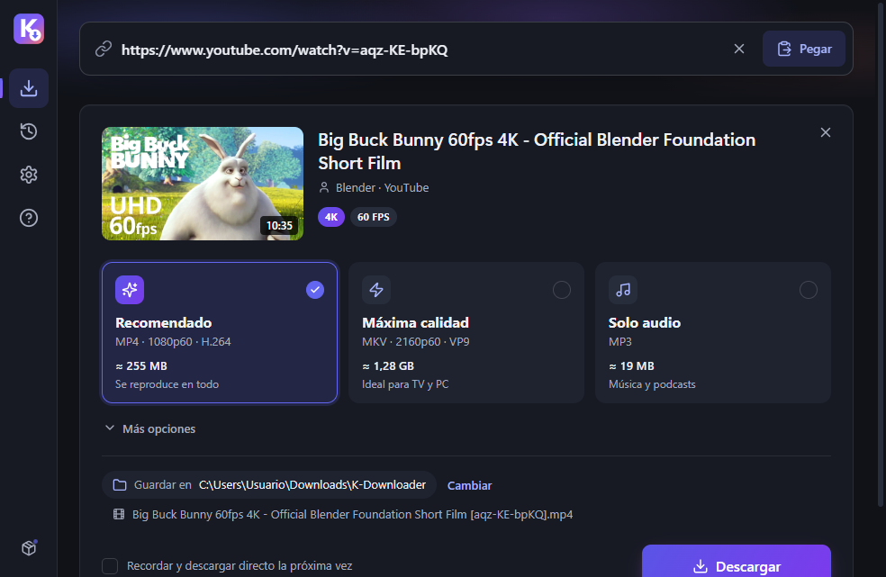
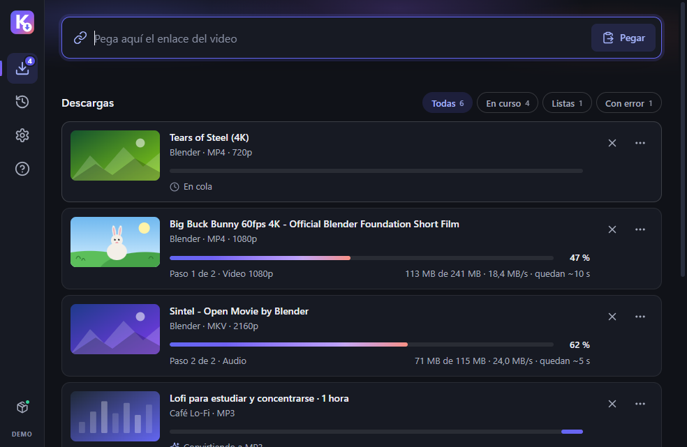

<p align="center">
  
</p>

<h1 align="center">K-Downloader</h1>

<p align="center">
  Descarga tus videos favoritos en la mejor calidad, con una app moderna para Windows.<br>
  <sub><a href="#english">Read in English</a></sub>
</p>

<p align="center">
  <a href="https://kdownloader.vercel.app/descargar"></a>
</p>

<p align="center">
  <a href="https://kdownloader.vercel.app/descargar"><b>Descargar para Windows</b></a> ·
  <a href="https://github.com/Kasaco223/K-YoutubeVideoDownloaderHD/releases">Todas las versiones</a> ·
  <a href="https://kdownloader.vercel.app/ayuda">Centro de ayuda</a>
</p>

<p align="center">
  <a href="https://github.com/Kasaco223/K-YoutubeVideoDownloaderHD/releases/latest"></a>
  <a href="https://github.com/Kasaco223/K-YoutubeVideoDownloaderHD/actions/workflows/ci.yml"></a>
  <a href="LICENSE"></a>
</p>

<!-- Capturas: se agregan en docs/screenshots/ (cómo generarlas: docs/screenshots/README.md). -->
<p align="center">
  
  
  
</p>

---

## Qué es K-Downloader

K-Downloader es una app gratuita y de código abierto para Windows:

1. Pegas el enlace de un video.
2. Eliges la calidad.
3. Lo tienes en tu carpeta Descargas.

Por dentro usa [yt-dlp](https://github.com/yt-dlp/yt-dlp), el motor de descarga más completo que existe. La app lo mantiene al día sola, para que siga funcionando cuando YouTube cambia algo.

Es la versión 2.0 de este proyecto (antes "YouTube Ultra HD Video Downloader"), reconstruida desde cero.

## Funciones

- **Pega y descarga:**
  - pega con `Ctrl+V` en cualquier parte o arrastra el enlace a la ventana;
  - puedes pegar varios enlaces a la vez;
  - si copiaste un enlace, la app te lo sugiere al volver a la ventana.
- **Calidad real, sin sorpresas.** Ves la calidad exacta que vas a bajar y el tamaño aproximado antes de descargar:
  - **Video recomendado:** MP4 hasta 1080p (H.264 + AAC). Se reproduce en cualquier PC, TV o celular.
  - **Máxima calidad:** la mayor resolución disponible, hasta 4K u 8K y 60 fps, en MKV.
  - **Solo audio:** MP3 con portada. En *Más opciones* también hay M4A y resoluciones concretas.
- **Progreso de verdad:**
  - la etapa ("Paso 1 de 2 · Video 1080p", "Uniendo audio y video");
  - la velocidad y el tiempo restante;
  - una cola con hasta 4 descargas simultáneas.
- **Listas de reproducción:** baja solo un video o la lista completa.
- **Errores que se entienden:**
  - un mensaje claro y un botón para resolverlo ("Actualizar y reintentar", "Elegir otra calidad"…);
  - los detalles técnicos se copian con un clic.
- **Se arregla sola:**
  - el motor se actualiza sin reinstalar nada;
  - ante un error típico de YouTube (403), actualiza y reintenta por su cuenta.
- **Historial** con búsqueda: abrir, mostrar en la carpeta, descargar de nuevo y copiar el enlace.
- **Descarga rápida** con tu formato favorito.
- **Desde el navegador:** botón "Abrir en K-Downloader" en la web y un marcador para tu barra de favoritos.
- **Español e inglés**, tema claro u oscuro y opción para reducir las animaciones.
- **Otros sitios:** está pensada para YouTube, pero también abre enlaces de muchos sitios compatibles con yt-dlp.

## Cómo funciona

| Pieza | Qué es | De dónde sale |
| --- | --- | --- |
| La app | Interfaz HTML/CSS/JS en una ventana de [pywebview](https://pywebview.flowrl.com/) (WebView2) | Este repositorio |
| Intérprete | **Python oficial** 3.13 *embeddable*, firmado por la Python Software Foundation | python.org, dentro del instalador |
| Motor | **yt-dlp** como *zipapp*: un archivo de Python puro, no un `.exe` | GitHub de yt-dlp. Canal **nightly** por defecto, **estable** opcional |
| Conversor | **FFmpeg** *release essentials* (une audio y video, convierte a MP3) | [gyan.dev](https://www.gyan.dev/ffmpeg/builds/) |
| Componente de YouTube | **Deno**, el entorno de JavaScript que yt-dlp usa para los desafíos de YouTube | GitHub oficial de Deno |

- **Primer uso:** la app descarga los componentes, unos 160 MB, desde sus fuentes oficiales.
  - Comprueba cada archivo con el **SHA-256** que publica su autor.
  - Si un archivo no coincide o no tiene hash publicado, no lo instala.
  - Deno se baja en segundo plano: puedes empezar a descargar antes de que termine.
- **Motor siempre al día:**
  - revisa si hay un yt-dlp nuevo una vez al día y también cuando YouTube devuelve errores;
  - cada versión se instala en su propia carpeta, sin tocar las descargas en curso;
  - conserva la anterior para volver atrás.
- **Arreglos de emergencia:** si YouTube rompe algo, el mantenedor puede publicar una pista en [`engine.json`](engine.json) (por ejemplo, "exigir yt-dlp ≥ X") y todas las instalaciones la reciben sin una versión nueva de la app. Detalles en [docs/engine-hints.md](docs/engine-hints.md).
- **La app también se actualiza:** te avisa cuando hay una versión nueva y, si aceptas, baja solo el código nuevo (~1 MB), verifica su SHA-256 y se reinicia.
- **Para desarrolladores:** la arquitectura completa está en [docs/architecture.md](docs/architecture.md).

## Instalación

**Requisitos:**

- Windows 10 (versión 1803 o posterior) u 11, de 64 bits.
- Unos 400 MB libres y conexión a internet.
- [Microsoft Edge WebView2 Runtime](https://developer.microsoft.com/microsoft-edge/webview2/), que ya viene con Windows 11 y con Windows 10 actualizado.

**Pasos:**

1. Descarga **`Instalar-K-Downloader.cmd`** desde <https://kdownloader.vercel.app/descargar> (o desde [Releases](https://github.com/Kasaco223/K-YoutubeVideoDownloaderHD/releases/latest)).
2. **Si el navegador avisa** que el archivo "no se descarga habitualmente" o "puede dañar tu equipo", elige **Conservar** (*Keep*).
   - En Edge: menú **…** de la descarga → **Conservar** → **Mostrar más** → **Conservar de todos modos**.
3. **Ábrelo con doble clic.** Si aparece *"Windows protegió tu PC"* (SmartScreen), pulsa **Más información** → **Ejecutar de todas formas**.
   - Pasa con todo programa nuevo que todavía no tiene firma digital. Lee [por qué no hay un .exe](#por-qué-no-hay-un-exe).
4. **El instalador:**
   - baja `kd-bundle-<versión>.zip` (unos 25 MB) desde GitHub Releases;
   - comprueba su SHA-256 y lo instala **solo para tu usuario** en `%LOCALAPPDATA%\Programs\K-Downloader`, sin pedir permisos de administrador;
   - crea el acceso directo en el menú Inicio y abre la app.
5. **En el primer uso**, acepta el aviso de uso responsable y espera a que la app prepare sus componentes.

> **¿Es seguro el instalador?** Es un archivo de texto: puedes abrirlo con el Bloc de notas antes de ejecutarlo.
>
> - Solo usa `curl.exe` y `tar.exe`, que vienen con Windows.
> - Se detiene si el SHA-256 del paquete no coincide con el que trae escrito.

**Desinstalar:** Configuración → Aplicaciones → Aplicaciones instaladas → **K-Downloader** → **…** → **Desinstalar**.

- Tus videos descargados no se tocan.
- Para borrar también los ajustes, el historial y los componentes del motor, elimina la carpeta `%LOCALAPPDATA%\K-Downloader`.

### Por qué no hay un .exe

Windows 11 trae **Smart App Control**, que bloquea cualquier `.exe` nuevo que no esté firmado o que Microsoft todavía no conozca. Un `.exe` hecho con PyInstaller o un instalador de Inno Setup quedarían bloqueados en esas PC sin dar opción a abrirlos. La firma de código cuesta dinero y la reputación tarda meses.

Por eso K-Downloader **no genera ningún ejecutable propio**:

- La app es código Python que corre sobre el `pythonw.exe` **oficial firmado** por la Python Software Foundation.
- yt-dlp corre como *zipapp* de Python puro.
- FFmpeg (de gyan.dev) y Deno (firmado) ya tienen reputación en Windows.
- El instalador es un script `.cmd` que puedes leer.

El resultado funciona incluso con Smart App Control activado. Si algún día el proyecto obtiene firma de código (ver la [política de firma](#política-de-firma-de-código)), podría ofrecer un `.exe` firmado.

## Preguntas frecuentes y solución de problemas

<details>
<summary><b>Me sale "Error 403" o "YouTube cambió algo"</b></summary>

YouTube cambia su sitio a menudo y eso rompe a todos los descargadores por un tiempo.

- La app **actualiza el motor y reintenta sola**.
- Si el error sigue, todavía no hay arreglo: espera unas horas. En cuanto yt-dlp publique la corrección, la app la instalará sola.
- También puedes forzarlo en **Ajustes → Componentes → Actualizar**.

</details>

<details>
<summary><b>Los videos "para niños" tardan más</b></summary>

YouTube entrega los videos marcados como "para niños" con más restricciones, así que el análisis y la descarga pueden ser más lentos. Es normal: dale unos segundos más.

</details>

<details>
<summary><b>Los videos para mayores de 18 solo bajan en 360p</b></summary>

Hoy, sin una sesión iniciada, YouTube solo entrega esos videos en 360p. La app te avisa antes de descargar.

Puedes intentarlo con un `cookies.txt` de una cuenta verificada en **Ajustes → Avanzado**, con los riesgos de la siguiente pregunta.

</details>

<details>
<summary><b>¿Debo usar cookies?</b></summary>

Casi nunca. Solo hacen falta para contenido que exige una cuenta (privado, de miembros o para mayores de 18).

- **Riesgo:** usar tu cuenta con un descargador puede hacer que YouTube la marque o la suspenda. Si lo haces, usa una cuenta secundaria.
- **Un `cookies.txt` equivale a tu sesión:** quien lo tenga entra a tu cuenta. Nunca lo compartas ni lo subas a un issue.
- K-Downloader no usa cookies con YouTube salvo que tú lo pidas: con cookies, YouTube ofrece menos calidades.

</details>

<details>
<summary><b>¿Por qué no puedo usar las cookies de Chrome o Edge directamente?</b></summary>

En Windows, Chrome y Edge cifran sus cookies de forma que solo el propio navegador puede leerlas, y además bloquean el archivo mientras están abiertos. Ningún programa externo puede tomarlas de forma confiable.

Si de verdad necesitas una cuenta, exporta un archivo `cookies.txt` (formato Netscape) con una extensión de confianza y elígelo en **Ajustes → Avanzado**.

</details>

<details>
<summary><b>"Demasiadas descargas seguidas" o "comprueba que no eres un robot"</b></summary>

YouTube frena por un rato las conexiones que bajan mucho seguido, sobre todo con VPN o redes compartidas.

- La app activa el **modo tranquilo** (más pausa entre descargas).
- Espera unos minutos y, si usas VPN, desactívala.

</details>

<details>
<summary><b>Windows bloqueó un componente, o el antivirus lo borró</b></summary>

La app lo detecta y ofrece **Reparar**: vuelve a bajar el componente desde su fuente oficial y verifica su SHA-256.

Si tu antivirus lo vuelve a borrar, es un falso positivo: repórtalo a su fabricante.

</details>

<details>
<summary><b>¿Dónde quedan mis archivos y los registros?</b></summary>

| Qué | Dónde |
| --- | --- |
| Videos | `Descargas\K-Downloader` (se cambia en Ajustes) |
| Ajustes, historial y componentes | `%LOCALAPPDATA%\K-Downloader` |
| Registro de la app (para reportar errores) | `%LOCALAPPDATA%\K-Downloader\logs\app.log` |

</details>

¿No está tu problema? Revisa el [centro de ayuda](https://kdownloader.vercel.app/ayuda) o [abre un issue](https://github.com/Kasaco223/K-YoutubeVideoDownloaderHD/issues/new/choose).

## Privacidad

K-Downloader **no tiene telemetría**: no envía estadísticas, no tiene cuentas ni anuncios y no rastrea qué descargas. Solo se conecta a:

| Destino | Para qué |
| --- | --- |
| GitHub | Revisar si hay una versión nueva de la app y leer las pistas del motor (`engine.json`), una vez al día. Bajar yt-dlp y Deno. |
| gyan.dev | Bajar FFmpeg. |
| Los sitios de los enlaces que pegas | Analizar y descargar el video, como haría tu navegador. |

- Puedes apagar la búsqueda de actualizaciones de la app y del motor en **Ajustes**.
- Los registros y el historial se quedan en tu PC.
- Si usas un `cookies.txt`, solo lo lee yt-dlp en tu equipo.

## Uso responsable

Descarga solo contenido que tengas derecho a guardar: el tuyo, el que tiene una licencia que lo permite o el que la ley de tu país te deja copiar para uso personal. Respeta a los creadores y los términos de cada sitio.

K-Downloader **no evade protecciones** (DRM), no baja contenido de pago y no ayuda a saltarse bloqueos regionales. Más en <https://kdownloader.vercel.app/uso-responsable>.

## Desarrollo

Necesitas Windows 10 u 11 y Python 3.11 o posterior. La app distribuida corre en Python 3.13; el CI prueba ambas versiones.

```powershell
git clone https://github.com/Kasaco223/K-YoutubeVideoDownloaderHD.git
cd K-YoutubeVideoDownloaderHD
python -m venv .venv
.venv\Scripts\pip install -e ".[dev]"
.venv\Scripts\python -m kdownloader
```

> En desarrollo, la app usa la misma carpeta de datos que la versión instalada. Para separarlas: `$env:KD_DATA_DIR = "$env:TEMP\kd-dev"`.

**Ver la interfaz sin Python (modo simulado):**

```powershell
cd src\kdownloader\ui
python -m http.server 8000
```

Abre <http://localhost:8000/index.html?mock=1&scenario=S4>.

- `scenario` va de `S0` a `S9`:
  - S0 bienvenida, S1 inicio, S2 analizando, S3 formato, S4 descargas;
  - S5 listo, S6 error, S7 historial, S8 ajustes, S9 ayuda.
- Agrega `&theme=light` o `&theme=dark` y `&lang=es` o `&lang=en`.

| Carpeta | Contenido |
| --- | --- |
| `src/kdownloader/` | Backend en Python: ventana, puente con la UI, cola, historial, actualizaciones |
| `src/kdownloader/engine/` | Motor: componentes, procesos, presets, progreso, errores, pistas |
| `src/kdownloader/ui/` | Interfaz HTML/CSS/JS, sin build ni frameworks |
| `packaging/` | Build del bundle e instalador `.cmd` |
| `web/` | Sitio estático (kdownloader.vercel.app) |
| `tests/` | Pruebas con pytest |
| `docs/` | Arquitectura, publicación y pistas del motor |

Cómo colaborar: [CONTRIBUTING.md](CONTRIBUTING.md).

### Pruebas

```powershell
.venv\Scripts\ruff check src tests
.venv\Scripts\pytest              # unitarias, sin red (las que corre el CI)
.venv\Scripts\pytest -m network   # motor real: usa internet, yt-dlp y FFmpeg
```

### Compilar

```powershell
powershell -ExecutionPolicy Bypass -File packaging\build.ps1
```

Deja en `dist/`:

- `Instalar-K-Downloader.cmd`
- `kd-bundle-<versión>.zip`
- `kd-app-<versión>.zip`
- `latest.json`
- `SHA256SUMS.txt`

Opciones: `-Version`, `-BaseUrl`, `-OutDir` y `-SkipTests`. No compila ningún `.exe`.

Para probar la instalación sin publicar:

```powershell
.\dist\Instalar-K-Downloader.cmd --local "$PWD\dist\kd-bundle-2.0.0.zip" --root "$env:TEMP\kd-prueba" --no-registry
```

### Publicar una versión

1. Sube `__version__` en `src/kdownloader/__init__.py`.
2. Haz merge a `master` y sube el tag `vX.Y.Z`.
3. GitHub Actions construye, prueba la instalación en limpio y deja el Release en borrador para revisarlo y publicarlo.

Checklist completa: [docs/release.md](docs/release.md).

## Política de firma de código

> **Estado: K-Downloader todavía no está firmado.** Esta política se prepara para postular al programa de firma gratuita para código abierto de [SignPath Foundation](https://signpath.org/). Cuando sea aceptado, esta sección dirá: *"Free code signing provided by [SignPath.io](https://about.signpath.io/), certificate by [SignPath Foundation](https://signpath.org/)"*.

**Qué se firmaría:**

- solo los archivos que **GitHub Actions construye desde este repositorio público** con el workflow [`release.yml`](.github/workflows/release.yml), a partir de un tag `vX.Y.Z`;
- nunca se firman builds hechos en una PC personal;
- nunca se firman programas de terceros (Python, yt-dlp, FFmpeg, Deno): se usan tal como los publican sus autores.

**Roles:**

| Rol | Persona |
| --- | --- |
| Autor (*committer*) | [Kasaco223](https://github.com/Kasaco223) |
| Revisor (*reviewer*) | [Kasaco223](https://github.com/Kasaco223) |
| Aprobador de cada firma (*approver*) | [Kasaco223](https://github.com/Kasaco223) |

**Reglas:**

- Todo cambio entra a `master` por pull request con el CI en verde.
- Las dependencias del runtime están fijadas con versión y SHA-256 en `packaging/requirements-runtime.txt`.
- Las cuentas de GitHub y de SignPath del equipo usan verificación en dos pasos.

**Privacidad:** este programa no envía información a otros sistemas en red, salvo lo que pide quien lo usa (analizar y descargar los enlaces que pega) y lo que se describe en [Privacidad](#privacidad): búsqueda de actualizaciones de la app y del motor y descarga de sus componentes, que se pueden desactivar en Ajustes.

## Créditos

K-Downloader existe gracias a:

- [yt-dlp](https://github.com/yt-dlp/yt-dlp), el motor de descarga.
- [FFmpeg](https://ffmpeg.org/), con los builds de [gyan.dev](https://www.gyan.dev/ffmpeg/builds/).
- [Deno](https://deno.com/).
- [pywebview](https://pywebview.flowrl.com/) y [pythonnet](https://pythonnet.github.io/).
- [Python](https://www.python.org/) y la Python Software Foundation.
- Los íconos de [Lucide](https://lucide.dev/).

Lista completa de componentes y licencias: [THIRD_PARTY_NOTICES.md](THIRD_PARTY_NOTICES.md).

## Licencia

[MIT](LICENSE). Los componentes de terceros conservan sus propias licencias ([THIRD_PARTY_NOTICES.md](THIRD_PARTY_NOTICES.md)).

## Aviso

K-Downloader es un proyecto independiente. **No está afiliado a YouTube ni a Google**, ni cuenta con su respaldo. YouTube es una marca de Google LLC; Windows es una marca de Microsoft Corporation. Cada persona es responsable de cómo usa la app.

---

## English

**K-Downloader** is a free, open-source Windows app to download your favorite videos in the best quality:

1. Paste a link.
2. Pick a quality.
3. The file lands in your Downloads folder.

It is powered by [yt-dlp](https://github.com/yt-dlp/yt-dlp) and keeps it up to date by itself, so it keeps working when YouTube changes things. This is version 2.0, a full rebuild of the former "YouTube Ultra HD Video Downloader".

**[Download for Windows](https://kdownloader.vercel.app/descargar)** · [All releases](https://github.com/Kasaco223/K-YoutubeVideoDownloaderHD/releases) · [Help center](https://kdownloader.vercel.app/ayuda)

### Features

- **Paste and go:** `Ctrl+V` anywhere, drag and drop, several links at once, and a clipboard suggestion.
- **Real quality before you download,** with an approximate size:
  - **Recommended:** MP4 up to 1080p (H.264 + AAC), plays everywhere.
  - **Max quality:** up to 4K/8K at 60 fps, in MKV.
  - **Audio only:** MP3 with cover art. M4A and specific resolutions are under *More options*.
- **Real progress:** step, speed and time left, with a queue of up to 4 parallel downloads. Playlists are supported.
- **Errors you can understand:** a clear message and a one-click fix.
- **Self-healing:** on a typical YouTube 403 error, it updates the engine and retries.
- **Also included:**
  - history with search;
  - quick download with your favorite format;
  - "Open in K-Downloader" from the browser;
  - Spanish and English, light and dark themes.

### How it works

- **The app:** HTML/CSS/JS UI in a [pywebview](https://pywebview.flowrl.com/) window (WebView2), running on the **official, signed Python 3.13 embeddable** distribution.
- **yt-dlp:** runs as a pure-Python **zipapp**, from the **nightly** channel by default (stable is optional). It updates itself daily and whenever YouTube starts failing.
- **FFmpeg:** *release essentials* builds from **gyan.dev**.
- **Deno:** the official build, used for YouTube's JavaScript challenges.
- **First run:** the components (about 160 MB) are downloaded from their upstream sources.
  - Each one is verified against its published **SHA-256**.
  - Nothing without a published hash is installed.
- **Emergency hints:** the maintainer can push hints through [`engine.json`](engine.json) without a new app release. See [docs/engine-hints.md](docs/engine-hints.md).

### Installation

1. Download **`Instalar-K-Downloader.cmd`** from <https://kdownloader.vercel.app/descargar>.
2. If your browser warns that the file is uncommon or may be harmful, choose **Keep**.
3. Double-click it. If SmartScreen shows *"Windows protected your PC"*, click **More info → Run anyway**.
4. **What the installer does:**
   - downloads `kd-bundle-<version>.zip` (about 25 MB) from GitHub Releases;
   - verifies its SHA-256;
   - installs **for your user only** in `%LOCALAPPDATA%\Programs\K-Downloader` (no admin rights needed);
   - creates a Start menu shortcut.

**Requirements:** Windows 10 (1803+) or 11, 64-bit, with the WebView2 Runtime.

**Uninstall:** Settings → Apps → Installed apps → **K-Downloader** → **Uninstall**.

- Your downloaded videos are kept.
- To remove settings, history and engine components as well, delete `%LOCALAPPDATA%\K-Downloader`.

**Why there is no .exe.** Windows 11 **Smart App Control** blocks new executables that are unsigned or not yet known to Microsoft. So K-Downloader ships no executable of its own:

- the app runs on Python's official signed `pythonw.exe`;
- yt-dlp is a Python zipapp;
- FFmpeg and Deno already have reputation;
- the installer is a readable `.cmd` script.

### FAQ

- **"403" or "YouTube changed something":** the app updates the engine and retries. If it persists, wait for a yt-dlp fix: the app installs it automatically.
- **"Made for kids" videos are slower:** YouTube serves them with more restrictions.
- **Age-restricted videos only download in 360p today** without a signed-in session.
- **Cookies:**
  - Using your account with a downloader may get it flagged. Use a secondary account.
  - Never share a `cookies.txt`: it is your session.
  - Chrome and Edge cookies cannot be read by external tools on Windows. Export a Netscape `cookies.txt` instead and pick it in **Settings → Advanced**.
- **Logs:** `%LOCALAPPDATA%\K-Downloader\logs\app.log`.

### Privacy

No telemetry, no accounts, no ads. The app only connects to:

- GitHub, once a day, for app updates, engine hints, yt-dlp and Deno;
- gyan.dev for FFmpeg;
- the sites whose links you paste.

Update checks can be turned off in Settings.

### Responsible use

Only download content you have the right to keep. K-Downloader does not bypass DRM, does not download paid content and does not help get around regional blocks.

### Development

```powershell
python -m venv .venv
.venv\Scripts\pip install -e ".[dev]"
.venv\Scripts\python -m kdownloader
```

**UI preview without Python:** run `python -m http.server 8000` inside `src\kdownloader\ui`, then open `http://localhost:8000/index.html?mock=1&scenario=S4`. Scenarios go from `S0` to `S9`; you can add `&theme=` and `&lang=`.

- **Tests:**
  - `pytest` runs the unit tests (offline);
  - `pytest -m network` uses the real engine.
- **Build:** `packaging\build.ps1` writes everything to `dist/`.
- **Releases:** push a `vX.Y.Z` tag. GitHub Actions builds the bundle, smoke-tests a clean install and drafts the release. See [docs/release.md](docs/release.md) and [CONTRIBUTING.md](CONTRIBUTING.md).

### Code signing policy

> **Status: K-Downloader is not code-signed yet.** This policy is prepared for the [SignPath Foundation](https://signpath.org/) open-source program. Once accepted, this section will read: *"Free code signing provided by [SignPath.io](https://about.signpath.io/), certificate by [SignPath Foundation](https://signpath.org/)"*.

**What gets signed:** only artifacts built by GitHub Actions from this public repository by [`release.yml`](.github/workflows/release.yml), from a `vX.Y.Z` tag.

- Local builds are never signed.
- Third-party programs (Python, yt-dlp, FFmpeg, Deno) are never signed by this project.

**Roles:**

- Committer: [Kasaco223](https://github.com/Kasaco223)
- Reviewer: [Kasaco223](https://github.com/Kasaco223)
- Approver: [Kasaco223](https://github.com/Kasaco223)

**Rules:**

- Every change reaches `master` through a pull request with green CI.
- Runtime dependencies are pinned by version and SHA-256.
- Team accounts use multi-factor authentication.

**Privacy:** this program will not transfer any information to other networked systems unless specifically requested by the user or the person installing or operating it. The only exceptions are the update checks and component downloads described under [Privacy](#privacy), which can be disabled in Settings.

### Credits, license and disclaimer

- **Credits:** [yt-dlp](https://github.com/yt-dlp/yt-dlp), [FFmpeg](https://ffmpeg.org/) (builds by [gyan.dev](https://www.gyan.dev/ffmpeg/builds/)), [Deno](https://deno.com/), [pywebview](https://pywebview.flowrl.com/), [pythonnet](https://pythonnet.github.io/), [Python](https://www.python.org/) and [Lucide](https://lucide.dev/) icons. The full list is in [THIRD_PARTY_NOTICES.md](THIRD_PARTY_NOTICES.md).
- **License:** [MIT](LICENSE).
- **Disclaimer:** K-Downloader is an independent project and is **not affiliated with YouTube or Google**. YouTube is a trademark of Google LLC; Windows is a trademark of Microsoft Corporation.
